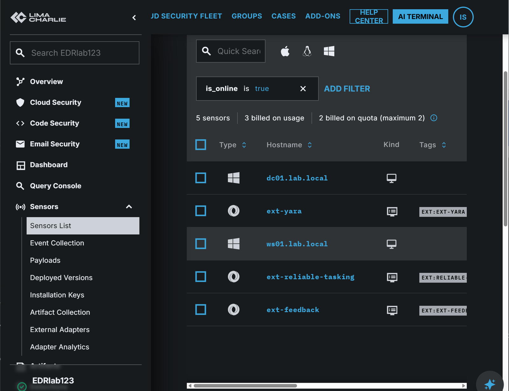

# SOC SIEM + EDR Lab

**Two of the three alert rules I wrote for an account lockout looked correct and could never fire.** This lab is a day of first-line SOC work on a small Windows domain: monitoring a SIEM and an EDR side by side, triaging what they raised, dismissing false positives with evidence, and escalating real incidents with a recommended action and approval requested before anything changes.

It builds on my [hybrid identity lab](https://github.com/IshSoundankar/iam-hybrid-identity-lab), adding a log server and endpoint sensors to the same `lab.local` domain.

## Setup

- **Domain:** DC01 (Windows Server 2022 domain controller), WS01 (Windows 10 workstation), SIEM01 (Windows Server 2022), all on one VirtualBox NAT network.
- **SIEM:** ManageEngine EventLog Analyzer on SIEM01, collecting Windows event logs from DC01 and WS01.
- **EDR:** LimaCharlie sensors on DC01 and WS01, with the managed Sigma ruleset.
- **Audit policy:** logons, process creation with command lines, account and group changes, PowerShell script block logging.

## Case log

| Ticket | Alert | Verdict | Action |
| --- | --- | --- | --- |
| [TKT-008](tickets/TKT-008-account-lockout.md) | Account lockout, `aoife.byrne` | True positive (simulated), escalated | Password reset and WS01 review recommended; alert rule fixed |
| [TKT-009](tickets/TKT-009-domain-admins-added.md) | Domain Admins membership added | True positive (simulated), escalated | Membership removal recommended; EDR rule gap logged |
| [TKT-010](tickets/TKT-010-smss-boot-false-positive.md) | Suspicious parent spawning smss | False positive, dismissed | Rule tuning recommended |
| [TKT-011](tickets/TKT-011-svchost-powershell-false-positive.md) | svchost masquerading, non-interactive PowerShell | False positive, dismissed | Rule tuning recommended |

Ticket numbers continue from TKT-001 to TKT-007 in the identity lab.

## What I found

- **The SIEM had the evidence but no alert.** The lockout (event 4740) was logged every time. The first rule matched a different event; the second searched the message text for the event ID, which the text never contains. Only the third, matching the Event ID field, fired. Each looked fine on screen; only testing against a real attack showed the difference. [Details](detections/eventlog-analyzer-alerts.md)
- **Each tool saw half of the brute force.** The SIEM saw the failed authentications on DC01; the EDR saw the `net use` command on WS01 that caused them. The case only made sense with both.
- **The EDR missed the privilege escalation.** The Sigma rule that matches `net group "Domain Admins"` deliberately skips commands containing `/add`, so removing a member was flagged and adding one was not. [Proposed rule](detections/limacharlie-net-group-add.yaml)
- **Most alerts were noise, and the noise had causes.** smss alerts fired on every boot; svchost alerts fired on the genuine System32 file because LimaCharlie writes paths as `\Device\HarddiskVolume2\...` while the rule expects `C:\...`.

## Limits

This is a three-machine lab with simulated attacks, Windows only. It does not cover firewall or cloud logs, and SIEM collection ran every 10 minutes rather than in real time.
