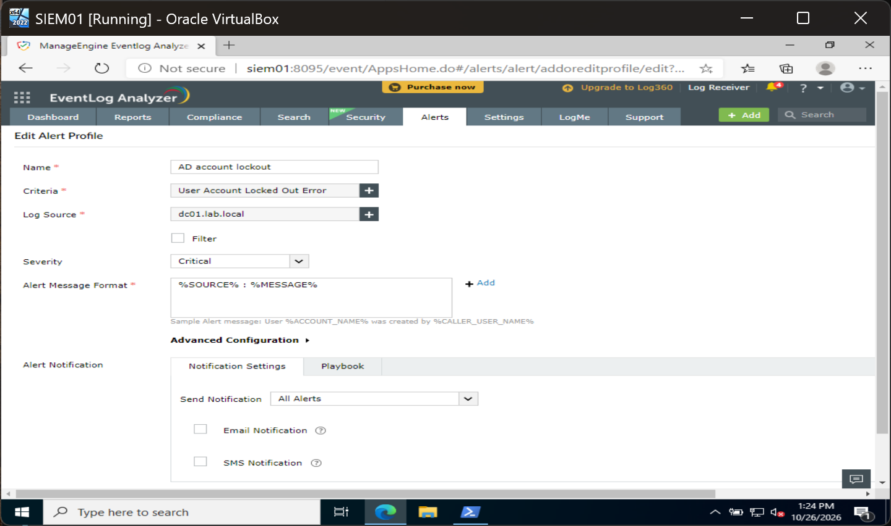
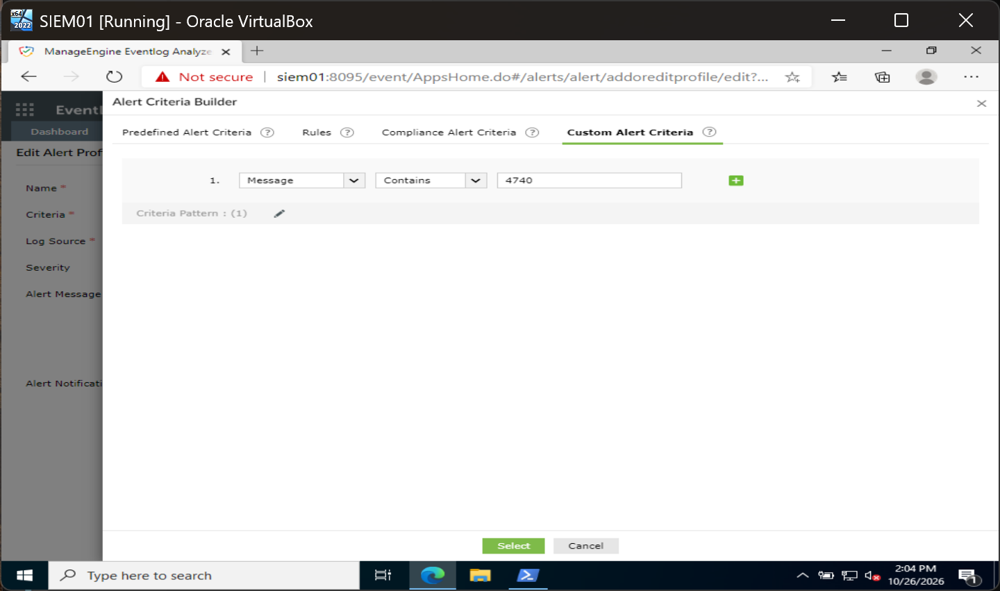

# EventLog Analyzer alert profiles

## Working alerts

| Alert profile | Criteria | Log source | Severity | Tested |
| --- | --- | --- | --- | --- |
| AD account lockout (4740) | Event ID equals 4740 | DC01 | Critical | Fired at 14:08:21 on a real lockout |
| Privileged group membership added | Event ID equals 4728 and Message contains `Domain Admins` | DC01 | Critical | Fired at 14:41:32 on the first test |

## How the lockout alert was fixed

The lockout was logged every time, but the alert took three attempts. Each was tested against a real lockout of `aoife.byrne`.

| Attempt | Criteria | Lockout tested | Result | Cause |
| --- | --- | --- | --- | --- |
| 1 | Predefined "User Account Locked Out Error" | 13:17:39 | No alert | Matches a different event from the lockout itself (4740) |
| 2 | Custom, saved from a search: Message contains 4740 | 13:37:02 | No alert | The Message field holds the event text, which never contains the event ID; the search worked because it looks across every field |
| 3 | Custom: Event ID equals 4740 | Rerun | Alert at 14:08:21 | Correct field |

Attempt 1:

Attempt 2:

The lesson carried over to the next rule: the Domain Admins alert used the Event ID field from the start and fired first time.

## Note on timing

SIEM01 pulled logs from DC01 and WS01 every 10 minutes, so an alert could arrive up to 10 minutes after the event. "Scan Now" was used to speed up testing.
