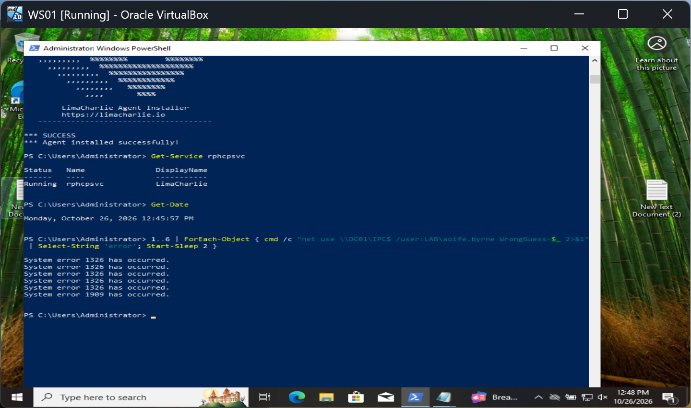
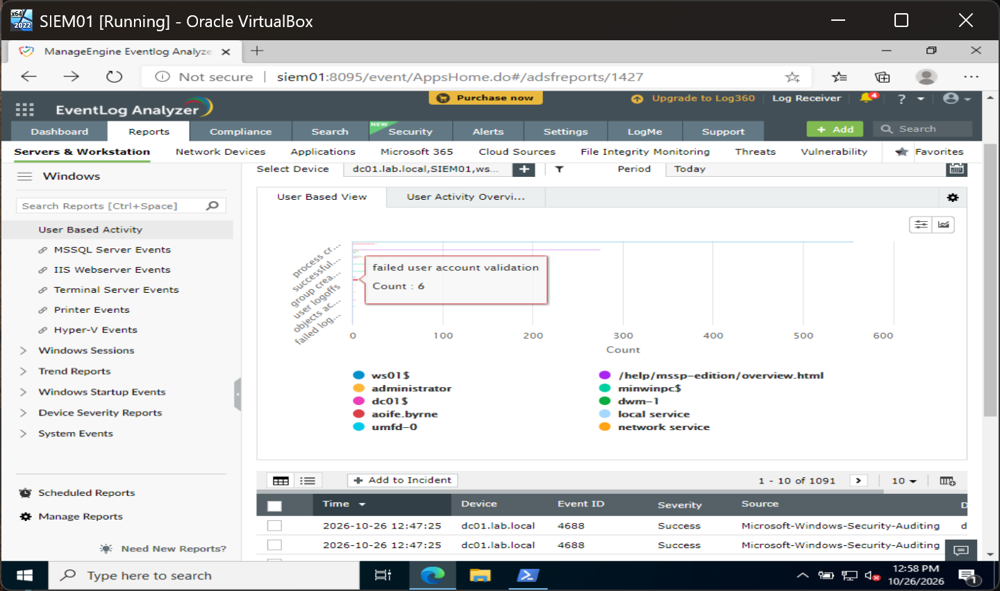
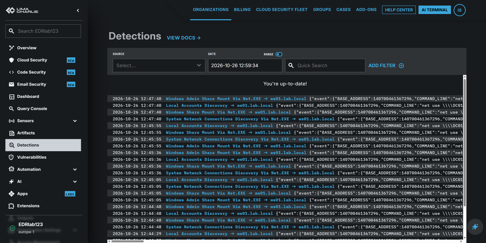
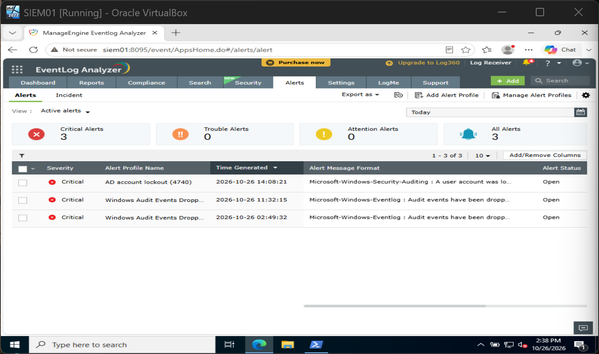

# TKT-008: Account lockout after password guessing

| Field | Value |
| --- | --- |
| Status | Escalated |
| Severity | Critical |
| MITRE ATT&CK | T1110 Brute Force |
| Source | WS01, `LAB\Administrator` |
| Target | `aoife.byrne` on DC01 |

**Alert:** six failed sign-ins for `aoife.byrne`, then a lockout (event 4740 on DC01 at 12:45:38).

**Checked:** DC01 logged WS01 as the source of the lockout. LimaCharlie showed `net use` on WS01 connecting to DC01 as that user at the same time, so the SIEM and EDR evidence belong to one incident.

**Verdict:** true positive, password guessing. Simulated for this lab.

**Recommended, approval requested:** confirm with the user; if the attempts were not theirs, reset the password and review WS01.

**Detection gap fixed:** no alert fired at first. Two rule versions failed against a real lockout; the third, Event ID equals 4740, alerted at 14:08:21. See [eventlog-analyzer-alerts.md](../detections/eventlog-analyzer-alerts.md).

## Evidence

Six attempts from WS01: five bad passwords (error 1326), then the locked account (error 1909).

The SIEM counted six failed validations for `aoife.byrne`.

The EDR flagged each `net use` command on WS01, four Sigma detections per command.

The fixed rule fired.

