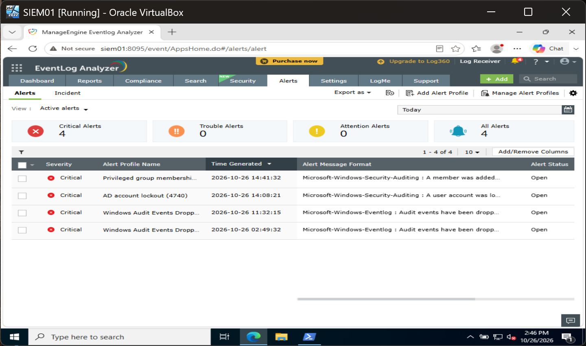
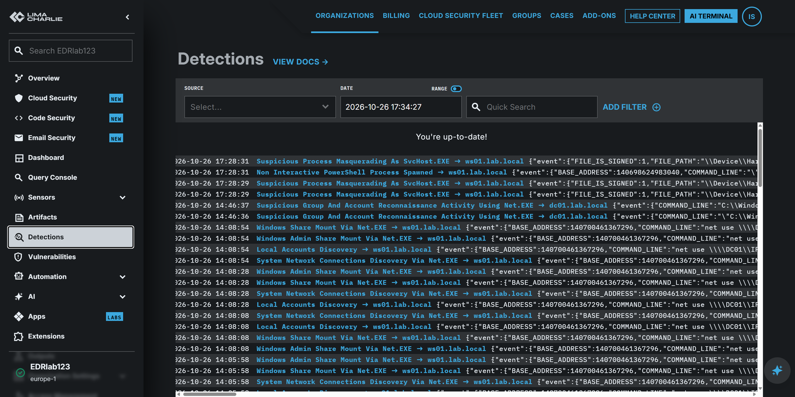

# TKT-009: Domain Admins membership added

| Field | Value |
| --- | --- |
| Status | Escalated |
| Severity | Critical |
| MITRE ATT&CK | T1098 Account Manipulation |
| Source | WS01, `LAB\Administrator` |
| Command | `net group "Domain Admins" ciaran.walsh /add /domain` |

**Alert:** "Privileged group membership added" (event 4728) at 14:41:32: `ciaran.walsh` added to Domain Admins from WS01.

**Checked:** no approved change on record. The EDR raised nothing for the addition. The Sigma rule that matches `net group "Domain Admins"` is a reconnaissance rule with a filter, `filter_group_add`, that skips any command containing `/add`. When the membership was removed at 14:46, that same rule fired. ([rule source](https://github.com/SigmaHQ/sigma/blob/master/rules/windows/process_creation/proc_creation_win_net_groups_and_accounts_recon.yml))

**Verdict:** true positive, unauthorised privilege change. Simulated for this lab.

**Recommended, approval requested:** remove the membership, reset the account's password and review its activity; add a custom EDR rule for `net group ... /add` ([proposed rule](../detections/limacharlie-net-group-add.yaml)).

## Evidence

The SIEM alerted on the addition.

The EDR shows no detection at 14:41; the removal at 14:46 was flagged as reconnaissance on DC01.

