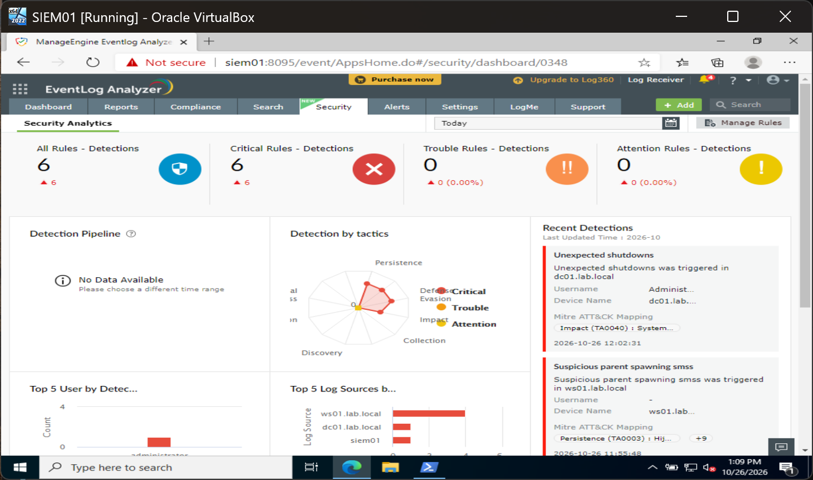

# TKT-010: smss spawned by unexpected parent

| Field | Value |
| --- | --- |
| Status | Dismissed |
| Severity | Critical (as raised) |
| Rule | EventLog Analyzer, "Suspicious parent spawning smss" |
| Hosts | WS01, SIEM01 |

**Alert:** "Suspicious parent spawning smss", four times: WS01 at 11:32:00, 11:51:27 and 11:55:48, and SIEM01 at 07:54:44.

**Checked:** WS01's System log shows a startup or shutdown (events 6005, 6006, 6008) at 11:32, 11:51 and 11:55, one for each alert. `smss.exe` only starts during boot. SIEM01's boot history was not checked.

**Verdict:** false positive. The rule fires on normal Windows startup.

**Recommended, approval requested:** tune the rule to exclude the normal boot sequence.

## Evidence

